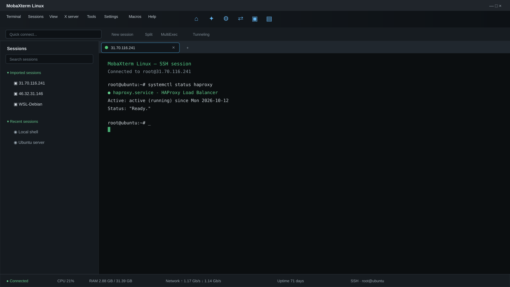

# MobaXterm Linux compatibility work

This is a clean-room compatibility project based on observed behavior and
static analysis of an authorized MobaXterm 25.4 / build 5418 installation.
It does not contain MobaXterm proprietary code.

## Current module

`mobaxterm_config.py` provides read-only inventory for:

- INI-style configuration/session files
- `.mxtpro` ZIP metadata

`session_store.py` provides a native SQLite database under
`~/.local/share/mobaxterm-linux/sessions.sqlite3`. It stores sanitized session
metadata only. `credential_store.py` integrates with the Linux Secret Service
through `secret-tool`; secret values are never stored in SQLite or command
arguments.

`separams_schema.py` parses the decoded MobaXterm session schema, and
`session_model.py` provides validated backend-neutral session objects. It never
stores password values; sessions refer to credential-store identifiers instead.

`ssh_backend.py` builds safe OpenSSH, SFTP, and Mosh command plans from those
session objects without launching network connections.

`terminal_backend.py` provides local Shell/Terminal/WSL command plans and a
POSIX PTY process wrapper for interactive terminal sessions.

`mobaxterm_cli.py` provides JSON session listing, local command capture, and
interactive PTY launching.

`mobaxterm_importer.py` converts recognized MobaXterm INI session sections and
encoded `Bookmarks*` records into validated Session objects. It excludes
secret-like fields during import and recognizes SSH, RDP, and WSL bookmark
records.

`connect` generates OpenSSH/SFTP/SCP/Mosh, FreeRDP, VNC, Telnet, Serial, and
WSL plans without connecting or handling passwords. It is dry-run by default;
`--execute` is required to launch a plan, and the executable is checked first.

`mobaxterm_gui.py` provides a Tk/WSLg session browser with PTY-backed tabs.
The GUI is intentionally a Linux-native compatibility layer, not a copy of
MobaXterm's proprietary terminal renderer.

## Ubuntu UI preview

The Tauri frontend uses a clean-room MobaXterm-style workspace with a dark
layout, toolbar, session sidebar, terminal tabs, ANSI terminal rendering,
split-pane-ready content area, and status bar.



This is a project UI preview, not a screenshot of proprietary MobaXterm code.

For large imports, use `--search` and `--type` to narrow sessions before
connecting. Ambiguous search results are rejected rather than guessed.

Credential-like values are redacted in summaries. The module never decrypts,
exports, or modifies secrets.

## Verify

```bash
mobaxterm-linux --help
mobaxterm-linux-gui
```

To build a Debian package:

```bash
./build-deb.sh
sudo apt install ./dist/mobaxterm-linux_0.1.1_amd64.deb
```

